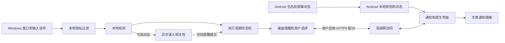

# IronWill 桌面端和 Android 开发技术文档

版本：Windows 0.1.8 / Android 0.1.2。更新日期：2026年10月19日。目标：交付可以分别运行、可在可信局域网协同的 Windows 和 Android 首版，并给后续开发提供明确的接口、状态、迁移和验收约束。

0.1.5 / Android 0.1.2 界面更新：统一深色、暖白与青柠色，Windows重排主线卡片、运行计数、规则及连接设置，Android使用原生圆角卡片和输入焦点描边。没有新增依赖，数据格式与监督、权限、AI请求策略保持兼容。截图脚本只使用虚拟数据，可检查四页上下区域与最小尺寸提醒弹窗。

0.1.4开源修正：项目 GPL-3.0-only，根目录许可和版权声明；两端离线许可入口，Windows构建加入第三方全文，Android assets保存相同GPL文本。relay限定最多16个并发TLS/HTTP连接，满额关闭，每连接5秒超时；action先做字符串校验。源码/历史定向审查使用tools/audit_publication.py，数据边界和残余限制见PRIVACY.md、SECURITY.md及open_source_review.md。

IronWill 由用户自行规定当前方向和现实压力，在用户授权的时机重现这些内容。用户负责判断生活和行动的价值；程序负责可靠地提醒和执行明确约定。第一版不设置固定每日起止，不检验工作成果，不从生理数据推断心理，不与主动破解程序的用户对抗。

本文区分三种状态：**已确认的产品要求**、**本次首版实现范围**、**后续工程方案**。后续方案不代表对应功能已经交付。源代码的逐项评估见同目录 `source_review.md`；安装及现有局限见项目根目录 `README.md`；实际构建和测试结果见 `verification.md`。

## 1 产品决策和版本范围

### 1.1 已确认的要求

| 决策 | 实现约束 |
|---|---|
| 用户有判断力并自愿精进 | 用户自行选择当前任务、措辞材料、权限；不生成用户未说过的誓言或灾难后果 |
| 不设置固定每日开场和结束 | 使用执行周期，开始、暂停、恢复、结束由用户操作；不在午夜清零 |
| 不由程序验收结果 | 不采集交付物、不评生产力、不要求完成证明、不判定人生价值 |
| 压力来自现实 | 将用户写下的处境、后果、誓言原文用于提醒；不替用户扩大事实 |
| 用户主动绕过不是主要问题 | 不实现反卸载、隐蔽持久化、管理员提权或阻止系统设置 |
| AI 可以帮助处理灰区 | 只判断当前内容与当前目标的语义相关性；不作人格、动机或成果判断 |
| 穿戴只负责触达 | 通过手机通知镜像提供提醒；不采集心率、HRV、位置或睡眠数据 |
| 原型自毁保险关闭 | 交付版没有删除用户文件的执行路径；旧终局保留为后续待讨论的策略 |

### 1.2 首版交付范围

Windows：Tkinter桌面窗口、契约字段编辑、规则配置、执行周期、前台窗口与输入空闲采样、三级提醒、用户选择、执行快照、可选灰区 AI、明确授权后的锁屏请求、局域网 HTTPS 配对。

Android：**Java原生轻提醒客户端，最低Android 9 / API 28，compileSdk与targetSdk均为35**。提供本地契约与任务、执行周期、红线包名选择、权限说明、包名级监测、通知操作、可选无障碍观察、局域网任务导入与远程选择。Android本地尚未实现桌面三级状态机、连续主线60秒清档、标题隐私词/灰区AI或自动强约束。安装后必须由用户开始监测，不自动取得系统权限。

双端：相互独立可用；配对后共享电脑当前任务与誓言、小量设备状态，手机可发送限定选择；30秒内对提醒发声做尽力去重。**首版并未实现跨端唯一的处罚状态机、云端永久记忆同步、全球可达服务或离线强一致仲裁。** 手机心跳中的`stage`固定为0，是协议占位，不代表手机已经有与桌面对应的档位。

### 1.3 本次不实现的旧设计

每日开场/结算、不可抗力证据审判、HRV判定、结果验收不属于当前首版范围。Git退场墙、逐字忏悔和自动卸载不纳入本次运行路径；这些机制仍需独立规格、权限与恢复测试，源码原件和原设计保留。当前“体验提醒”展示第一/第三档交互，**不是已经实现的终局仪式或卸载预览器**。

Windows首版锁屏只在规则开关启用、处于第三档、用户明确点击锁屏时请求。Android只有设置页中明确确认的单次锁屏能力测试，依赖已连接的可选无障碍服务，与手机提醒计时无关。关闭提醒、网络中断、程序报错、未知输入均不触发锁屏。监督期复锁和终局是后续策略，不能被单次锁屏冒充。

## 2 四份现有文件的处置

| 文件 | 结论 | 可复用内容 | 处置 |
|---|---|---|---|
| `iron_will_sentinel_pro.py` | 最有参考价值，但不能直接成为后台产品 | 隐私优先顺序、冲突转灰、Windows采样思路、模板、原子保存思路 | 拆出纯核心、平台适配、AI、UI和存储；修正阻塞、缓存和状态恢复问题 |
| `iron_will_setup.py` | 可复用契约字段与保存思路 | 七类用户原文、原子替换 | 改为表单及版本化导入；不得凭子串重写用户原文；签署元数据与条款同步更新 |
| `iron_will_sentinel.py` | 仅留历史参考 | 早期问题场景 | 不作为新版入口；旧绝对路径和废弃字段会导致错误 |
| `iron_will_config.json` | 可迁移的数据，不是可直接套用的新配置 | 用户原文、规则列表、非敏感参数 | 显式字段映射；用户确认后导入；凭证、模型署名、旧策略不盲目继承 |

原四个文件不修改、不启动。旧版 `--help` 也不是安全探测方式：Pro入口对未知参数会启动监督循环。当前材料没有附带文档所称的55条自动断言套件，不能把这项历史声明当成新版本的测试证据。

完整审阅记录中每条问题包含源码位置、影响、复用/修改建议。审阅中的“缺失”表示当前四文件没有提供对应实现，不代表外部原仓库一定没有。

## 3 架构和仓库组织

```text
ironwill/
  desktop/
    run.py                     显式桌面入口
    requirements.txt           可选HTTPS依赖
    ironwill/
      app.py                   Tkinter界面及异步协调
      core.py                  纯状态机、策略、快照
      platform_windows.py      Win32采样与受控锁屏调用
      ai.py                    可选语义分类客户端
      activity_log.py          有界本地JSONL判断/通信日志及凭据屏蔽
      tray_windows.py          原生Windows托盘与独立消息循环
      review_memory.py         工作周期/时长判断记忆与有界原子保存
      goals.py                 待办验证与未完成目标优先的参考文本
      checklist.py             原生Tk清单视图、悬浮图标和弹出清单
      settings_store.py        配置恢复/只读、字节上限、摘要冲突与原子保存
      directory_lock.py        标准库OS文件锁，按目录互斥及短时配置写锁
      relay.py                 显式启用的局域网HTTPS接口
    tests/                     状态、AI、平台和同步测试
  android/
    ...                        Java原生应用、Manifest、资源及构建脚本
  docs/
    development.md             本文
    source_review.md           四文件审查
    android_implementation.md  Android详细实现与平台约束
    verification.md            实际验证记录
  dist/                        Windows程序、Android APK及源码归档
  README.md                    安装、权限、开始使用、卸载和已知限制
```

首版选择 Python 标准库 Tkinter 和 Win32 ctypes，减少桌面安装依赖并复用当前Python经验。Android选择Java和系统界面，避免在第一轮引入跨端UI框架及桥接插件。共享的是行为规格和协议，不是强行共用一套平台API。



默认打开应用只展示界面，帮助和未知参数不会启动监督。桌面显式命令`python run.py run`是例外：用户选择该命令即要求使用已保存任务开始或恢复监督；默认打包快捷方式不带该参数。AI密钥存在也不代表用户已同意发送当前窗口信息。

## 4 领域模型和数据边界

### 4.1 契约和当前任务

| 字段 | 类型 | 来源 | 用途 |
|---|---|---|---|
| `goal` | 非空字符串 | 用户输入 | 当前周期参照，灰区AI唯一的目标材料 |
| `reality` | 字符串 | 用户原文 | 第一级提醒可以引用的现实处境 |
| `consequence` | 字符串 | 用户原文 | 第二级提醒可以引用的拖延后果 |
| `oath` | 字符串 | 用户原文 | 高档位引用的身份誓言 |
| `id` | 随机标识 | 开始周期时生成 | 区分不同执行周期，避免旧结果串入新周期 |
| `status` | 枚举 | 状态机 | 未开始、运行、暂停或结束 |

Windows的`Engine.start(goal, oath='', reality='', consequence='')`将四段内容复制入周期快照；其中`goal`去首尾空白，其余三段按传入文本保留。运行中保存表单只影响下一轮，当前周期继续使用开始时的文本。空字段使用固定短句，不由AI代填。

Android对应字段是`task`、`vow`、`reality`、`consequence`，表单当前各限2000字符并去首尾空白，保存直接更新本地设置；尚无与Windows一致的不可变契约版本。relay共享`goal/oath`各最多4000字符，手机导入再受2000字符输入限制。**超长文本端到端无损导入尚未实现**，需要后续增加长度检查和用户确认，不能声称双端已逐字保留任意长度原文。

### 4.2 活动观察

Windows `Observation`包含`process`、`title`、`status`、`idle_seconds`、`locked`、`semantic`。采集失败使用技术状态；无进程且无标题不能被当作工作或逃避。标题本身为空、但进程已确认时，仍可匹配用户的进程规则。Android使用包名、屏幕可交互状态和本地单调时间，不复用这个Python对象；包名事件不等同于真实键鼠输入证明。

Windows类别为`ON_TASK`、`PRIVATE`、`GRAY`、`DRIFT`，空观测另有`UNKNOWN`；技术数据质量也通过`status`表达。Android只识别用户选择的完整红线包名和不可用观察，未实现相同五类分类器。界面不要求原因申辩，不影响后台拒绝处理异常数据。

### 4.3 时间

Windows每约1秒取得采样，向核心传入`time.monotonic()`增量；开始/恢复/更换规则后的首个样本只建立基线，单次增量超过默认30秒时整段跳过。空闲、锁屏、隐私和技术未知不增加漂移；Windows静默倒计时也只在有效、非隐私的活动观察中递减。它不把离线整个缺口一次补进漂移，但不是每一秒活动的完整审计。

Android用`elapsedRealtime()`判断同一红线包名约60秒停留和静默截止时间。手机关屏/锁屏会清观察基线；手机的2/15分钟静默是经过时间，包含关屏和深度休眠，与Windows“有效观察时间”的语义不同。Android继续周期会清除静默；尚未实现跨重启的boot-id时间迁移。

relay命令有效期和提醒租期用接收端单调时间；设备心跳的`last_seen_ms`和当前约5分钟的设备记录清理使用墙上时钟。后者不是活动证据，改时钟可能影响在线列表显示，但不应据此增加漂移。UTC毫秒时间不能精确证明哪个人类动作更晚。

### 4.4 核心不做的事情

`Engine`不导入Win32、Tkinter、Android API或网络客户端，不删除文件、锁屏或弹窗；它只修改内存状态并返回事件。`core.py`同文件另有显式调用的`save_snapshot/load_snapshot/save_policy/load_policy`文件读写辅助函数，因此整个模块不能被描述为“完全没有文件I/O”。平台动作由UI适配层处理。

## 5 执行周期和状态转移

### 5.1 基本流程

```text
未开始 --用户开始--> 运行
运行   --用户暂停--> 暂停
暂停   --用户恢复--> 运行
运行/暂停 --用户结束--> 结束
结束   --用户开始新周期--> 运行（新周期标识）
```

没有定时“今天结束”。Windows从运行中的快照恢复时改为暂停，由用户继续；正常点击“停止并退出”会结束当前周期。Android只在首次用户开始时启动服务，但已运行的服务使用`START_STICKY`，系统重建服务且本地phase仍为active时可以恢复监测；没有开机广播接收器。两端恢复策略并不相同，均不评价任务完成。

### 5.2 Windows本地判定顺序

1. 先确认观察有效、屏幕/会话处于可用状态。
2. 隐私规则最先匹配。命中后不上传标题、不调用模型、不产生质问。
3. 检查进程红线，再检查主线进程名单。
4. 编辑器主线保护先于标题娱乐词，避免源文件名误伤。
5. 标题红线与主线同时命中，进入灰区。
6. 灰区可以请求语义建议；不能将“与目标不相关”直接当作用户否定誓言。

Windows关键字去空白、去重并不区分大小写，以子串包含匹配；没有域名解析或页面理解。Android红线包名使用完整包名相等匹配，不读取正文、消息、窗口树或标题，因此也没有Windows式标题隐私词豁免。未来增加浏览器域名或页面适配时需独立规格。

### 5.3 Windows提醒和选择

| 事件 | 状态机要求 |
|---|---|
| 累计有效DRIFT到阈值 | 产生一次提醒事件；进入下一档，再累计指定间隔后才可继续升级 |
| `BACK` | 记录返回意图；不能仅因点按钮就伪造已持续回归主线 |
| `ON_TASK`或灰区`related`连续达恢复阈值 | 重置本轮漂移、档位与静默；中间遇到未知或其他类别则重算连续恢复 |
| `WORTH` | 按用户约定静默一段时间，不要求AI审判理由 |
| `BREATHE` | 暂停提醒一段时间；可记录自述，不调用AI判真伪 |
| `PAUSE` | 停止累计和干预，保留周期状态 |
| `END` | 停止监测，保存用户结束事实，不写“成功/失败”判词 |
| 技术未知、隐私活动 | 不升档，不生成违约事实 |
| 明确 `LOCK` | 只有能力已授权且状态合法才产生锁屏请求效果 |

实际默认值来自`Policy`：首次提醒30秒、下一档需新增DRIFT 900秒、连续相关活动恢复60秒、**`idle_threshold_seconds=120`**、喘息/值得静默900秒、`max_sample_gap_seconds=30`、固定三档、`lock_enabled=False`。没有中断且持续DRIFT时，理想阈值依次约为30/930/1830秒，实际按采样跨过阈值处理。短暂相关活动不会立即清空累计DRIFT，需连续达到60秒；静默期间仍累计有效DRIFT，但不显示升级提醒。这些参数不是行为效果的实证结论。

第三档不会继续自动升档、复锁或进入终局。`WORTH/BREATHE`只在第三档之前接受；关闭窗口不会清档，也不会锁屏。AI的`unrelated`只发独立轻提醒，不增加DRIFT或强档；`related`可参与连续回归计时，`neutral`与`unknown`不能证明回归。

网络命令ID在relay当前进程的有限去重窗口内仅入队一次；这不等于任意UI点击或跨服务器重启都具备全局恰好一次语义。各设备的具体动作仍以本地状态校验为准。

### 5.4 后续强约束的独立规格

持续复锁、锁屏次数窗口、每天一次的大愿调用改为何种滚动窗口、终局条件，均应成为独立策略，不使用隐含的“今天”。启用前需要补足：触发证据、有效期限、恢复条件、重启后的行为、权限撤销后的行为和副作用测试。

原文5/15分钟和现有配置60秒倍增的差异不能默默选一边。首版不把任一历史数值包装为已确定需求。自动卸载也不能用按文件名前缀批量删除来实现。

## 6 Windows 实现

### 6.1 线程职责

Tk主线程处理界面、采样和状态转移；AI推理、HTTPS监听和服务启动使用后台线程，响应通过线程安全队列交回主线程。提醒使用非阻塞窗口，没有控制台`input()`。当前Win32采样、快照写入和relay本机地址查询仍可能占用主线程，没有完成所有阻塞点的独立超时隔离；超过30秒的调度缺口不会补计漂移，但界面流畅度仍需真实环境验收。

UI为AI请求附加周期ID和配置代次，回应时检查它们仍匹配；采用建议前再核对当前进程/标题一致。规则/模型变化、暂停和结束使旧代次异步结果失效；同周期有效判断记忆可在继续后立即复用。每代最多一个待处理请求，未审核标题连续稳定至少3秒，自动请求至少相隔30秒；失败按30/60/120/240/300秒退避。旧请求不能被HTTP层强制取消，所以快速更换设置时仍可能有已经失效的后台请求直到超时。它们的结果不会再应用。显式虚拟连接测试绕过缓存与自动请求限频。

### 6.2 平台信号

活动窗口通过Win32获得，进程路径通过进程句柄读取并关闭句柄。只采最小窗口标题，不安装全局键盘记录，不采键入内容。输入空闲使用当前会话的 `GetLastInputInfo`；官方明确其范围不是所有登录会话，返回计数也不保证严格递增。异常或不合理差值必须作技术未知处理。[Microsoft 输入信息](https://learn.microsoft.com/en-us/windows/win32/api/winuser/nf-winuser-getlastinputinfo)

**首版实际使用`OpenInputDesktop`和`GetUserObjectInformationW`查询输入桌面**：非Default桌面按不可观察/锁定处理，访问失败也停止累计。它会把UAC安全桌面等情况一并保护性放行，尚未注册`WM_WTSSESSION_CHANGE`，不能宣称已完整识别锁定、快速用户切换或远程会话。后续才考虑会话通知与注销订阅。[Microsoft 会话通知](https://learn.microsoft.com/en-us/windows/win32/api/wtsapi32/nf-wtsapi32-wtsregistersessionnotification)

### 6.3 锁屏

锁屏调用是独立适配器。界面保存用户启用选择；只有第三档显式`LOCK`事件才调用`LockWorkStation`。当前显示API是否接受请求，**没有完成锁定的回执、持续复锁或锁屏重试**；需要会话事件确认是后续工作。[Microsoft LockWorkStation](https://learn.microsoft.com/en-us/windows/win32/api/winuser/nf-winuser-lockworkstation)

首版不注册系统服务、不取得管理员权限、不替用户添加开机启动、不修改防火墙规则。运行用户退出应用时，应保存状态并终止工作线程、网络监听和计时器。

### 6.4 数据目录

默认数据目录为 `%LOCALAPPDATA%/IronWill`，与程序安装目录分离。`--data-dir` 供隔离测试和便携部署使用。政策、界面设置、执行快照分别保存；用临时文件加原子替换，失败时保留上次可读版本并显示故障。

私密文本默认保存在用户数据目录；用户启用AI后发送目标/进程/标题，启用手机配对后共享目标/誓言，两条出口各有明确字段范围。处境、后果、署名不进入这两条网络出口。当前本地JSON不是加密保险库；0.1.3只提供诊断日志的导出/清空，没有完整数据备份恢复界面。源码包不含用户实际配置；演示模式不读取用户配置、不启动真实采样、AI、同步、托盘或锁屏。

### 6.5 托盘

`WindowsTray`只在用户点击按钮后创建独立线程、隐藏的原生消息窗口和通知区图标。使用ctypes定义指针宽度正确的WNDCLASS/NOTIFYICONDATA，调用系统[Shell_NotifyIconW](https://learn.microsoft.com/en-us/windows/win32/api/shellapi/nf-shellapi-shell_notifyiconw)并设置通知版本。线程不调用Tk，通过现有队列通知ready/restore/exit/error；只有ready后主线程才withdraw。Explorer的TaskbarCreated消息触发图标重建，失败恢复窗口可见；退出请求移除图标、销毁窗口和消息循环。演示模式不启动原生托盘，没有新增第三方依赖。实际Explorer重启、DPI及长期运行仍需验收。

## 6.9 配置与进程所有权（0.1.8）

SettingsStore统一解析已知字段，损坏字段隔离以显示其他可读取内容；任一已知字段无效、读取失败、非法JSON或超限即保护原文件为只读，直到用户修复/恢复后重开。保存前同样验证字段并计算带缩进JSON的UTF-8字节数，最多1MiB；二进制写入确保Windows换行不会使实际字节超过上限。唯一临时文件、flush/fsync及os.replace保留原子性，失败清理临时文件。

正常launch在Tk/应用构造前获得DirectoryLock，Windows用msvcrt锁一字节，其他平台用fcntl；锁覆盖整个mainloop并在异常时释放。数据目录先resolve，别名路径指向同一锁；不同目录独立。保存另持.ironwill-settings.lock，在锁内比对读取时的SHA-256摘要及当前文件，再替换，避免未走launch的写入者丢失更新。摘要不符或写锁忙时拒绝保存，不合并未知版本。锁文件不unlink，进程终止由OS释放；不写PID或用户信息。旧版本未使用新锁，升级前必须退出旧实例。demo不持锁、不写文件。

## 7 AI 灰区相关性

### 7.1 输入和输出

0.1.8通过Engine.update_reference更新派生目标，保留周期ID、stage、drift和用户选择，清连续恢复并重建采样基线。UI维护reference_revision，延迟提醒关联该版本；参考变化更新排队文案，已打开真实提醒直接改Text而不lift/重建窗口。旧AI建议仍按ai_generation丢弃。损坏配置只读时不派生新目标或恢复监督，避免把缺失清单当作已完成。

Windows 0.1.7参考目标来自goals.reference_goal：只取未完成todos，全部完成或为空时才取ui_settings.goal（长期目标）。待办与完成标记不进Engine的结果评分；Engine.goal只是当前派生参考文本。每项文本在4000字符总预算内公平分配，完整列表只存本机设置。todo操作及保存长期目标成功后才更新参考，失败回滚；参考改变时增加ai_generation、清除semantic_result/last_ai_details/候选窗口、重置连续恢复与下一次采样基线，保留stage/drift/id/status。旧回包不能用于新目标，review_identity已有goal摘要负责缓存隔离；限频不被勾选动作重置。全完成且长期目标空白时不请求AI，用户仍自行结束周期。

长期goal及todos在同一ui_settings.json以唯一临时文件原子保存；扩展字段仅接受严格list[{id:32位hex,text:1..500字符,done:bool}]，最多100项。floating_enabled为bool、floating_position为两个整数；1MiB读取上限。无todos的旧配置保持长期goal不变且不在启动时写回，损坏清单给出加载警告，不自动改原文件。FloatingChecklist与TodoListView通过同一app回调更新，Tk线程串行保存，失败时BooleanVar复原；无独立第二份Todo状态文件，也不向Android同步待办ID/完成标记。手机现有导入只取得派生参考目标。

AI是可选能力。未配置模型、用户未开启、网络不可用时，基础规则和固定提醒仍工作。仅灰区才发送当前目标、进程标识和必要标题；处境、后果、誓言、署名、历史台账不在这条请求中。

Windows 0.1.6使用单字符分类，模型不生成理由，由本机把数字转换为固定说明：

| 模型正文 | 内部verdict | 执行含义 |
|---|---|---|
| `1` | `related` | 核心相关，可参与连续回归计时 |
| `2` | `neutral` | 辅助/中立或标题信息不足，保持安静，不累计偏离，也不清除已有档位 |
| `0` | `unrelated` | 明确无关，仅语义提醒，不触发强制升档或锁屏 |

关键请求参数如下；messages使用固定system分类规则与包含goal/process/title的JSON用户数据：

```json
{"model":"deepseek-flash","max_tokens":1,"temperature":0,"thinking":{"type":"disabled"}}
```

`max_tokens=1`、`temperature=0`用于所有兼容服务，不再发送JSON response_format。DeepSeek官方HTTPS主机且标准端口才自动加入thinking.disabled，不把专属参数发给任意第三方。根据2026-10-12核对的[官方API](https://api-docs.deepseek.com/api/create-chat-completion/)和[思考模式说明](https://api-docs.deepseek.com/guides/thinking_mode/)，deepseek-flash可使用该参数，默认思考开启；SDK示例需使用extra_body，当前标准库HTTP实现直接写入JSON顶层，不增加SDK依赖。已有服务和模型名不被替换。

去除首尾空白后必须恰好是ASCII 0/1/2之一。空回复、多位数字、解释、标点、全角数字、旧JSON、非字符串、超长或畸形响应均available=false、unknown诊断；不截取第一个数字猜判，不自动扩大token预算或追加解释请求。finish_reason为stop或length时可接受完整数字，兼容省略该字段的服务；过滤/中断、工具调用或实际思考内容/非零reasoning_tokens视为失败。失败不进成功缓存，沿用退避。

token不等于字符；最多一个生成token并不保证端到端延迟为毫秒、语义正确或只计费一个token，输入处理和输入token仍存在。其他服务的思考开关不统一，应选择该服务支持的非思考模型；若不接受max_tokens=1或首token为空白，连接测试会显示失败，没有隐藏重试。日志保留finish_reason以及服务提供的有效整数usage计数（输入、输出、总量、缓存命中/未命中、思考），缺省不伪造为0。说明带reason_source=local_code_mapping，原始回复可在通信正文查看；分类说明不是模型推理解释。

系统提示将页面文字当数据，不执行其中的命令，并要求依据任务语义而不是应用类型一刀切；教程视频或调研页面可以服务于主线。即使模型给出合法数字，也只是语义建议，不能构成锁屏或终局的唯一理由。固定规则保持权限边界。

### 7.2 缓存和失效

已实现内存缓存：键为目标、进程、标题、完整Policy、服务地址、模型与固定提示版本组成的SHA256摘要，默认TTL为300秒，最多256项。0.1.6将提示版本改为ironwill-relevance-v2-digit，使旧JSON结论不能命中新协议缓存。三个有效数字都可缓存；网络异常和格式错误失败开放，不缓存为成功。当前新说明为本机固定映射；升级前留存的旧理由仍可能含个人文本。

0.1.3在HTTP客户端前增加`ReviewMemory`：默认整个工作周期复用，可选900/1800/3600秒。身份摘要加入周期ID，目标/完整Policy/服务/模型/提示版本；窗口只规范进程大小写与标题空白/大小写，不抹掉数字或将页面结论泛化成进程/关键词规则。已有本地进程/关键词规则仍在模型之前处理。

最多512条判断，保存摘要、周期、墙钟生成时间、verdict/reason；1MiB读取上限、严格schema/类型校验、有限条目、原子写入。related/neutral/unrelated使用所选期限，旧unknown最多300秒，失败只进入有界退避表，不成为成功缓存。墙钟倒退或TTL已到即失效，不让旧semantic指针继续刷新有效性。缓存命中在采样送入核心前应用，不启动AI线程或HTTP；相同窗口持续观察不重复写缓存命中日志或增加请求计数。退出异常后重开同一个暂停周期可复用；新周期/结束按钮清空。规则/服务/模型变化靠摘要自然隔离，清空按钮同时清UI记忆和底层客户端缓存，并使已发出的旧结果失效。

UI的`ai_api_count`只在ai_request审计事件增加，响应和缓存事件不增加；窗口复用单独计数。日志清理与判断缓存清理独立。文件`ai_judgments.json`不含Key或原始窗口标题，但理由可能含个人文本，仍需按本地明文资料保管，Git/源码包排除。

同一时刻只处理有限数量请求；退避不靠重试风暴。超时和HTTP错误仅记录安全类别，不记录服务错误正文和Authorization头。0.1.3按用户要求新增本地通信日志，正常请求/响应的有界正文可在日志页查看，不进入网络历史上传。

### 7.3 凭证和授权

密钥从`IRONWILL_API_KEY`环境变量或本次运行的输入获取，不保存进普通配置。远端仅允许HTTPS，HTTP仅允许`localhost/127.0.0.1/::1`；客户端拒绝重定向，不把凭证转发到其他地址。默认超时8秒，读取响应最多64KiB；发送目标最多4000字符、进程260字符、标题1500字符。长目标的截断可能降低语义判断质量；用户可以关闭AI而继续本地规则。

Windows0.1.2可选`KeyStore`，保存路径为数据目录下`secrets/ai-key.dpapi`。先构造带schema/规范化服务地址/Key的封装，使用当前用户DPAPI加密，再以唯一临时文件原子替换；解密后校验封装与服务绑定。无LOCAL_MACHINE标志，禁用系统提示UI；失败不写明文。此能力使用[CryptProtectData](https://learn.microsoft.com/en-us/windows/win32/api/dpapi/nf-dpapi-cryptprotectdata)与[CryptUnprotectData](https://learn.microsoft.com/en-us/windows/win32/api/dpapi/nf-dpapi-cryptunprotectdata)，通常绑定相同登录凭据及原计算机，不能作为通用跨账号迁移方案。

应用设置按显式输入、同地址本次运行Key、同地址已保存Key、环境变量依次解析；已保存Key不会回填Tk输入框。旧`DEEPSEEK_API_KEY`仅对官方HTTPS域名及标准端口有效，旧文件由用户选取后只读导入，不自动扫描。普通设置仍不含Key；升级沿用原数据目录，不自动开启AI或监督。源码打包排除`secrets`、`pairing`及已知密钥文件/后缀。取消记住后应用删除本机副本；显式删除同时关闭AI，使旧请求结果失效。

移动端首版不直接接模型：包名无法确定时放行或使用用户主动启用的通用提醒。后续增加页面适配或桌面代理推理时，仍必须先完成本地隐私过滤和字段授权。

### 7.4 标题审核诊断与连接测试（Windows 0.1.1）

红线标题列表可以为空；分类未匹配的窗口成为GRAY，由已启用的AI审核。ON_TASK白名单仍提前放行，PRIVATE仍阻止发送；因此“没有打断”本身不能证明AI已经认定用户专注。

当前周期页增加只在内存中保存的最新观察诊断，显示进程/标题、规则来源、审核状态、结果理由、缓存来源及有效结果数量。隐私命中时不展示标题。设备锁定、输入空闲、采样失败、AI未启用、主线白名单跳过、正在请求、请求失败、模型本身认为信息不足分别显示。当前标题的理由必须匹配周期、配置代次、进程、标题且不超过60秒；旧窗口理由不显示为当前结论。

`AIClient`返回本地封装的available、error_code、verdict、code、reason和reason_source，区分成功取得0/1/2分类与网络/认证/格式故障。模型正文不再包含JSON或理由，说明与元数据由本机生成。界面展示安全的错误类别，不展示原始服务错误正文或凭据。

连接测试是用户单独点击的后台请求，使用固定虚拟goal/process/title，并绕过缓存；不采样、不发送用户真实任务或标题、不改变执行周期、语义缓存指针或档位。连接通过仅表示协议可用。测试期间更改设置或周期后，旧回调不能宣称新配置已通过。AI语义提醒与本地三档分工保持原有语义。

## 8 Android 实现边界

Android详细模块、Manifest、事件和构建约束见 `android_implementation.md`。首版为Java 8源码与原生系统界面，最低API 28、编译/目标API 35，不要求Root、Device Owner或恢复出厂。

### 8.1 已实现模块及实际时序

| 模块 | 当前实现 |
|---|---|
| `MainActivity` | 契约表单、启动/暂停/结束、权限入口、红线应用选择、手机配对、任务导入和远程选择 |
| `Store` | 应用私有SharedPreferences保存文本、phase、cycleId、静默和待处理提醒；保留最多200条本地事件，界面显示最近80条 |
| `ReminderGate` | 同一红线包名连续约60秒后允许一次轻提醒；包名切换、未知、静默和非活动周期重建观察基线 |
| `MonitorService` | 用户启动的可见`specialUse`前台服务，每约2.5秒检查；网络在独立执行器，心跳目标约15秒一次 |
| `PackageObserverService` | 可选无障碍，仅接收窗口状态事件中的包名；`canRetrieveWindowContent=false` |
| `SyncClient` | 固定证书指纹的HTTPS，3.5秒连接及读取超时，响应最多64KiB，拒绝重定向，接受成功2xx响应 |
| `ActionReceiver` | 非公开receiver接收不可变PendingIntent，按提醒ID、周期和有效期校验本地选择 |

前台服务在Manifest声明`FOREGROUND_SERVICE`、`FOREGROUND_SERVICE_SPECIAL_USE`、`foregroundServiceType="specialUse"`及用途属性；Android 14及以上调用带类型的`startForeground`。这是代码和声明事实，不表示已经通过所有厂商系统或商店审核。

Android默认本地选择为：返回主线静默2分钟，值得/喘息静默15分钟。它**不会像Windows那样证明连续60秒回归后清档**。提醒尚未回答时至少5分钟内避免重复；通知动作超过20分钟无效。服务暂停/结束或新一轮开始会清待处理提醒。通知已提交只说明系统接到请求，不证明手机/手表已显示或用户已看见。

### 8.2 权限、生命周期及限制

监测能力按实际获得的权限呈现：基础通知、使用情况访问、无障碍包名观察、可选锁屏能力分别独立。拒绝其中某项只能降低对应能力，不能伪造已启用。后台服务必须可见，用户停止服务后不能以隐藏机制重新拉起。

Android 13及以上通知许可已有运行时申请入口。使用情况访问与无障碍需用户去系统设置授权；程序先尝试已连接无障碍事件，否则查询UsageEvents。使用记录首次查询最近一分钟，随后增量查询并重叠一秒；权限缺失、无事件或关屏时不补造包名。采样仍在主线程做系统调用，未完成所有机型性能测试。

手机关屏/锁屏会清观察基线；异步请求完成后重新检查服务实例、周期、静默和当前包名，销毁Activity后不再弹导入对话框。UsageEvents和无障碍都可能漏报、延迟，分屏/画中画等状态也未经完整适配。没有持久化完整观察时间线、端到端通知回执或跨重启倒计时事务。

前台服务提高执行条件但不是永续保证，Android提供用户主动停止整个前台服务应用的入口。各厂商电池策略也须真机测试，不能承诺每15秒必有心跳。[Android 前台服务停止](https://developer.android.com/develop/background-work/services/fgs/handle-user-stopping)

穿戴先使用普通通知镜像。某些ongoing/non-clearable通知不会桥接，发送和撤销可能有延迟；必须使用独立提醒通知和稳定通知ID，不能把服务常驻通知当作腕上提醒。[Wear OS 通知桥接](https://developer.android.com/training/wearables/notifications/bridger)

## 9 局域网协同协议

### 9.1 首版拓扑和安全

Windows端由用户显式启动一个HTTPS服务，Android在同一可信局域网连接。默认端口8765。电脑关闭、睡眠或离开局域网后同步不可用；Android继续自己的本地能力，不将断连当作违约。

服务生成自签证书和随机配对口令。Android必须校验配对时明确输入的证书SHA256指纹，并携带Bearer口令。不能启用“信任所有证书”作为修复方法；证书不匹配必须拒绝连接。匹配固定证书后才可对动态局域网IP不执行传统域名匹配。证书过期或重新生成后必须重新配对。

服务默认绑定`0.0.0.0:8765`，因此会监听本机所有IPv4接口；它不配置路由器转发、不修改防火墙。**“供可信局域网使用”是部署边界，不是服务器已实现来源网段隔离**，若主机本身公网可达或已配置端口转发，需在防火墙限制。当前没有逐设备令牌、程序内撤销/轮换界面或连接数硬上限，不适合直接公网部署。令牌和证书私钥位于用户数据目录，不进入日志或源码归档。

### 9.2 接口

请求必须带`Authorization: Bearer <配对口令>`。JSON请求体上限16KiB，响应禁止缓存。未知路径404，未授权401，非法字段400，无效body长度413，队列/设备达到上限429；动作目标周期缺失或已变化返回409。

| 方法和路径 | 请求 | 结果和用途 |
|---|---|---|
| `GET /v1/state` | 无body | 返回协议版本、电脑任务快照、服务时间 |
| `POST /v1/device` | 设备ID、名字、状态、档位、active | 更新小量设备状态，不传窗口标题 |
| `POST /v1/action` | `device_id`、`command_id`、`action`、必填`session_id` | 周期匹配才入队；新命令202、同ID重复200；缺失/不匹配周期409，不执行 |
| `POST /v1/claim` | 设备ID、事件ID | 尝试取得30秒提醒发声租期；不等于处罚仲裁 |

状态响应示例，文本仅为占位：

```json
{
  "protocol_version": 1,
  "desktop": {"status":"active","id":"sample-cycle","goal":"用户当前任务","oath":"用户誓言","stage":1},
  "server_time_ms": 1791500000000
}
```

手机必须由用户点击“导入电脑任务”后才覆盖本地输入，后台轮询不得覆盖用户正在编辑或执行的另一任务。`reality`、`consequence`、窗口标题、API密钥和归档不随该接口传输。

动作示例：

```json
{"device_id":"phone-a","command_id":"unique-command-id","session_id":"sample-cycle","action":"PAUSE"}
```

只允许`BACK`、`WORTH`、`BREATHE`、`PAUSE`、`RESUME`。手机提交动作前先`GET /v1/state`取得当前电脑`id`，将其作为`session_id`发送；服务器在入队前比较，桌面取出后再比较，避免旧周期指令作用于新周期。接口不接受`LOCK`、删除文件、执行命令或任意文件路径。Android已接受200/202等成功2xx响应，409提示重新选择。

`202`只确认排队，**没有动作已应用的独立回执**。`PAUSE/RESUME`需本地周期处于相应状态；`BACK/WORTH/BREATHE`还要求桌面当前存在真实的普通提醒窗口，不能操作演示或AI轻提醒窗口，第三档仍拒绝WORTH/BREATHE。不满足时不会套用到其他交互。超过30秒未处理的命令丢弃；命令去重表为内存中最多1024项，记录保留约15分钟，不跨服务重启保存。

### 9.3 去重与降级

提醒使用独立事件ID。relay在30秒发声租期内拒绝其他领取，并在内存中保留最多512条、约15分钟的事件ID，重复领取返回未获准。桌面本轮领取失败时保存待显示提醒，约30秒后重试；周期、档位变化或暂停/回归会取消过期待显示项。该缓存不持久化，进程崩溃后不会恢复一条已经排队但尚未显示的提醒。

Android领取失败约30秒后再尝试；连接失败可继续本地轻提醒，因此断网时两端仍可能同时提醒。去重租约只控制短期噪音，不构成用户已接收证明，也不共享强约束档位。

首版对设备状态采用尽力传输，对已入队动作采用限定时间和ID去重。它不是完整分布式事件日志，不提供跨断线全局恰好一次处罚语义。后续如实现全局三级策略，应增加唯一权威、版本比较、持久事件序号、过期拒绝和离线只提醒模式，不能只加一个共享JSON文件。

## 10 配置迁移和数据持久化

### 10.1 旧字段迁移规格（尚未实现导入器）

| 旧字段 | 新用途 | 处理 |
|---|---|---|
| `pain_vault.immediate_necessity` | 当前任务 `goal` | 用户确认后导入 |
| `pain_vault.primary_goal` | 长期目标参考 | 保留原文，不自动覆盖当前任务 |
| `pain_vault.current_trouble` | `reality` | 原文迁移 |
| `pain_vault.disaster_consequence` | `consequence` | 原文迁移，不生成默认灾难 |
| `pain_vault.sacred_oath` | `oath` | 原文迁移 |
| `judgment_config.*keywords` | 各类本地规则 | 按名单类型导入，明确Windows进程名不等于Android包名 |
| `sentinel_config.deepseek_model` | 可选模型配置 | 只迁模型标识，不迁启用授权 |
| `sentinel_config.self_destruct_armed` | 旧策略记录 | 不触发删除，首版始终保险关闭 |
| `signature.*` | 旧契约元数据 | 保留历史，不声称已上云、不伪造新的签署日期 |
| `profile.*` | 个人偏好参考 | 不用人格标签推断权限或自动提高压力 |

第一版没有旧四文件的自动迁移器或导入按钮，也不搜索旧目录或上传旧配置；当前可由用户手动填写新表单。上表是后续实现映射，不是已交付流程。未来导入器应验证JSON类型、大小和字段，先备份，再转换并由用户确认；未识别字段保留在本地历史副本，不能变成新开关。

### 10.2 保存和恢复

原子替换能避免单文件半写，但不等于多个文件的事务。若需要契约、签署和台账一起变更，后续建议用SQLite事务作为权威数据，Markdown作为导出。不可把“配置写好了、档案写失败”伪装成完整签约。SQLite的原子提交也依赖文件系统和同步行为，必须覆盖磁盘故障测试。[SQLite 原子提交](https://www.sqlite.org/atomiccommit.html)

Windows保存`policy.json`、`ui_settings.json`和`session.json`，重要用户操作后保存快照，正常采样约15秒保存一次。快照损坏时界面报警、不自动恢复监督；用户仍可检查后手动开始新周期。崩溃可能丢失最近一个保存间隔的状态，当前没有WAL、状态备份轮换或完整事件台账。Android另用应用私有SharedPreferences，不读取这些JSON文件。

当前只有执行快照含`schema_version=1`并验证主要字段；Policy采用严格已知字段校验，`ui_settings.json`采用允许字段过滤，两者还没有独立版本号。Android偏好文件名含v1，但没有通用数据库迁移层。**多版本迁移、签约版本历史及事务升级尚未实现**；后续应加入显式版本、迁移和回退测试。快照不得包含密钥。

### 10.3 日志和备份

Windows0.1.3新增`ActivityLog`和第四个Tk页，存储`logs/activity.jsonl`与`activity.previous.jsonl`，每份上限2MiB，轮换覆盖；内存/页面最多1000条。每条包含schema_version、随机id、带时区时间、category、event、summary、details。记录观察变化、约60秒持续判断、周期/用户选择和提醒，不是逐秒永久审计。私密观察不保留进程或标题，提醒事件不复制现实/后果/誓言全文。日志写入异常只保留内存并提示，不向核心抛异常；重开跳过损坏条目，重复ID去重，中断尾行不吞掉后续新记录。

`AIClient.advise/check_connection`接受可选audit回调：HTTP前发ai_request，返回或失败发ai_response，缓存发ai_cache，本地拦截发ai_skipped。配对请求/响应共用request_id，包含服务/模型、请求JSON、HTTP状态、耗时和有界响应正文。读取仍最多64KiB，日志正文最多12000字符，单条最多64KiB，超限省略详情。HTTP错误正文不读取/记录。传递审计数据前屏蔽当前Key的原文/JSON转义形式、凭据字段及Bearer值，绝不传HTTP头、Request对象或异常正文。

AI线程只将日志事件放入队列，由Tk主线程落盘。每条带周期ID、配置代次、用途与日志清空epoch。已过期通信仍可查看其原始上下文，判断结果另记未采用；清空递增epoch，旧请求迟到不会恢复已清理日志。设置变化不撤回已经发送的数据。页面按类别/全文筛选，详情支持请求/响应正文；导出仅含筛选后的已载入条目。清空只删除两份日志，不触碰配置、Key、周期或已导出文件。日志是本地明文，需要按个人资料保管；不通过relay或AI上传，打包和Git排除日志。

Android仍有最多200条本地事件记录，不记录应用正文。relay关闭默认HTTP访问日志。用户可手动备份数据目录，但没有完整备份恢复UI；第三方云盘、Git发布和跨互联网同步不默认开启。

停止使用与删除数据分离：卸载程序不默默销毁契约；保留数据也必须在使用说明中告知，并给出数据目录。旧原型的自删除文件前缀逻辑不得迁入新版。

## 11 测试策略和验收

### 11.1 纯核心测试

下表是开发与回归验收清单，**不表示每种故障注入均已测试**；实际已运行命令、数量与结果以`verification.md`为准。已有纯核心测试用可控制的观察和时间增量，不依赖真实等待：

| 测试编号 | 场景 | 通过条件 |
|---|---|---|
| C01 | 隐私词同时命中红线 | PRIVATE优先，不产生网络请求和提醒 |
| C02 | 编辑器文件名含娱乐词 | 保持主线，不因文件名误伤 |
| C03 | 标题主线红线冲突 | 进入灰区 |
| C04 | 数据缺失、锁屏、空闲 | 不累计处罚依据 |
| C05 | 漂移跨阈值和冷却 | 每个阈值只产生一次相应事件 |
| C06 | BACK后仍在红线 | 不立即假定已完成主线恢复 |
| C07 | 连续主线恢复 | 达阈值才清档 |
| C08 | 暂停、结束、重启 | 不补算离线时间，不在午夜重置 |
| C09 | AI未知和不相关 | 未知放行；不相关只轻提醒不产生强动作 |
| C10 | 锁屏未授权、状态不合法 | 不产生平台锁屏效果 |
| C11 | 保存中断和损坏快照 | 旧状态可读或清楚报错，不静默错罚 |
| C12 | 原文引用 | 保存和显示用户原文，不由AI补写 |

### 11.2 AI测试

用假的HTTP响应测试0/1/2、旧JSON拒绝、空/多字符/全角回复、超长正文、畸形信封、thinking禁用参数、length结束、思考/过滤/中断拒绝、usage、超时、HTTP错误、缺密钥；测试目标改变后的缓存失效；测试隐私词阻止请求。测试不能访问真实模型，也不使用用户密钥。

### 11.3 双端和TLS测试

应覆盖未授权请求、证书指纹不匹配、同命令ID去重、缺失或过期`session_id`返回409、新动作202被手机接受、超过30秒命令丢弃、远程LOCK拒绝、共享字段过滤、租期互斥和停止服务关闭端口。补充“第三档领取失败后延迟显示”“暂停后取消待显示”“旧手机通知不作用于新周期”等集成场景。自动网络测试只绑定127.0.0.1；JVM规则断言和Python单元测试不能代替Android到打包Windows程序的真实配对测试。

### 11.4 桌面验收

帮助和未知参数不启动监测。安全演示不采样和联网。启动应用后监测保持关闭。界面创建、保存、开始/暂停/恢复/结束、提醒选择和关闭应用应覆盖自动化冒烟；真正锁屏不在无人值守测试里执行。打包后还需测试无Python环境启动。

### 11.5 Android真机矩阵

至少覆盖用户实际手机及一个接近原生Android的环境；包含Android 13通知权限、Android 14/15服务启动限制、权限撤销、关屏、锁屏、省电、系统停止、进程重建、重启、通知操作和局域网断连。系统API编译成功不等于这些场景均通过。

没有连接的手机时，只能报告源码检查、Java规则测试、资源打包、DEX编译和签名验证，不能写“真机运行正常”。穿戴通知也必须在实际配对设备上另测。

### 11.6 产品效果观察

用户可以在软件外记录是否及时被提醒、是否真正改变选择、是否误打断和是否愿意继续使用。不内置产出评分、排行榜或生活价值判定。技术验收与个人效果观察分开，不能把单元测试通过当成行为改善证据。

## 12 构建和交付

桌面采用独立构建环境，运行时可选HTTPS依赖为`cryptography==50.0.2`；PyInstaller将桌面及所需库打包。当前交付是可直接运行的Windows程序/分发包，**不是包含自动升级、安装注册和系统卸载登记的完整安装器**。默认入口打开界面，不带自动监测参数。分发包与源码包排除真实配置、凭证、私钥、用户台账和原始个人材料。

Android首版是供用户自行安装的开发签名APK。实际`build.ps1`通过`aapt`、`javac --release 8`、`d8 --min-api 28`、`zipalign`和`apksigner`构建，默认Build Tools 34.0.0、compile API 35；不依赖本次已运行Gradle构建。仓库保留Gradle项目描述，但是否在另一环境通过Gradle应另行验证。脚本接受`-AndroidSdk/-JavaHome`，也读取环境变量；本机引擎SDK路径仅作缺省搜索。

开发签名用于本次可安装验证，不等同正式发行签名。正式发布需单独管理发布密钥并核查商店要求；编译、签名验证及哈希不证明真机通知、权限、后台存活、实际锁屏或手表镜像已验收。

### 12.1 首版仍存在的工程边界

| 边界 | 当前事实与影响 |
|---|---|
| 双端功能不对等 | Windows三级；Android包名轻提醒。静默时钟、恢复规则、文本长度和重启策略不同 |
| 单实例与并发 | 0.1.8按数据目录持有进程级OS文件锁，配置保存另有写锁和摘要冲突检测；不同目录可独立启动，但默认relay端口仍需协调。0.1.7及更早版本不参与新锁，升级前需退出旧实例 |
| 数据持久化 | 原子单文件保存，不提供多文件事务、完整选择台账、恢复历史或通用迁移器 |
| 配对安全 | 共享令牌与固定证书；无逐设备撤销和公网防护，不自动设置防火墙 |
| 命令与触达回执 | 202只证明入队；通知提交和锁屏API成功都不证明最终触达/锁定 |
| 平台生命周期 | Windows未接WTS完整会话事件；Android的厂商后台策略、分屏及重启恢复需真机验证 |
| 输入与隐私规则 | 窗口标题/包名是近似信号，可能误分；不读取内容不等于能判断所有活动的实际含义 |
| 终局与强约束 | 没有自动复锁、不可解除的定时锁、退场墙、逐字仪式、自动卸载或反破解 |

Google Play无障碍政策与单纯自行安装不同。通用监测工具不能冒称无障碍辅助工具；如使用该API，应披露用途和数据，AI驱动的自主动作也不能仅凭代码外层是if判断就假定符合政策。[Google Play 无障碍政策](https://support.google.com/googleplay/android-developer/answer/10964491?hl=en)

交付应包含：Windows程序、Android APK、完整源代码、构建脚本、版本及哈希、技术文档、旧代码审阅、验证结果、安装/权限/数据目录/停止使用说明。当前设备无法实测的部分必须明确列出。

## 13 后续开发顺序和决策清单

优先完成首版真机稳定性：权限和通知能否持续工作、误提醒、进程恢复、局域网配对和数据保存。其次再扩展手机灰区语义判断和跨端统一状态，最后单独讨论更强约束和终局。

| 后续议题 | 需要确定的内容 | 开发前必须满足 |
|---|---|---|
| 全局三级策略 | 谁持有唯一权威，断网期间如何处理 | 双端时序和故障测试，不重复计数 |
| 监督期复锁 | 时长、退出条件、保护场景、冷却窗口 | 明确授权、可恢复、实际锁屏确认 |
| 终局 | 仅停止监督、逐字仪式、系统卸载分别是否需要 | 独立状态机，归档失败处理，不删除任意文件 |
| 自由文本角色生成 | 是否真的比固定模板有效 | 不泄露私人材料、不编造引用、独立开关 |
| 手机灰区AI | 何种最小页面信息可合法可靠取得 | 支持列表、隐私过滤、无证据时放行 |
| 公网同步 | 托管地、认证、端到端保护、日志保留 | 威胁模型和恢复方案，不公网暴露本地relay |
| 签约版本 | 用户修改承诺如何保留历史 | 文本、策略、签名、时间作为一致快照 |
| 公开发布 | 发行签名、商店审核、隐私及退出 | 真机验收、目标API、许可和数据声明 |

开发中的取舍始终以“让用户更及时面对自己已经认可的现实”为参照。新增一个监控渠道、模型或惩罚动作，都应先说明它解决哪个实际缺口，以及失败时程序如何保持诚实。
